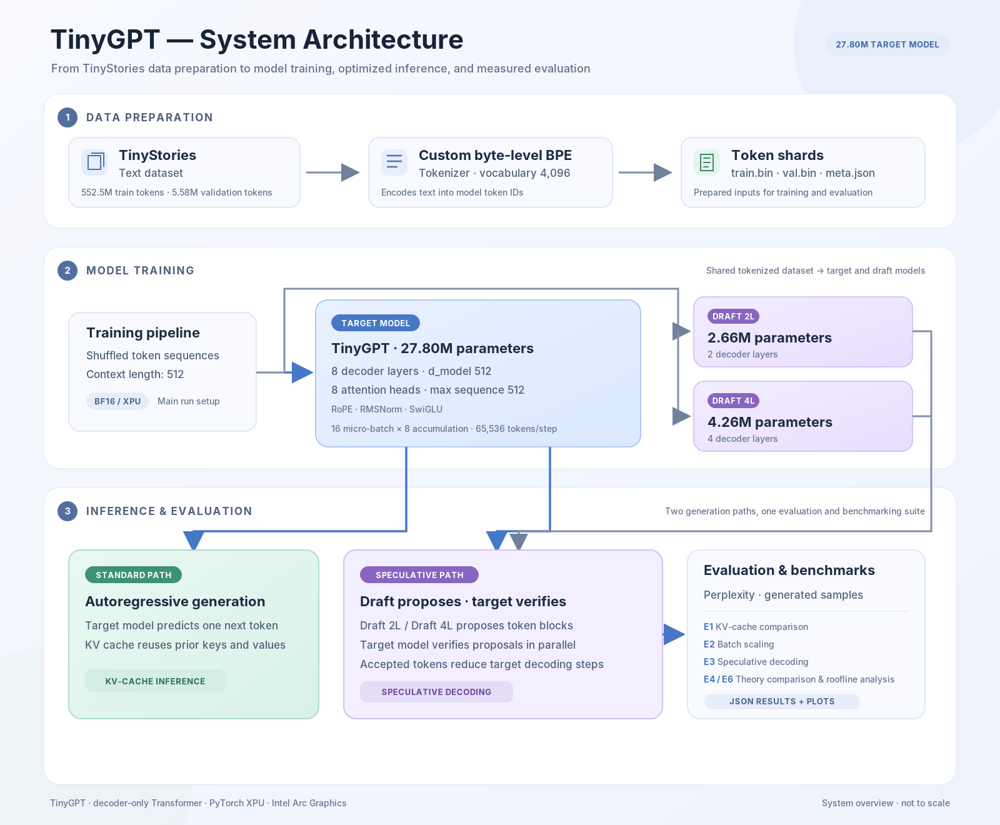
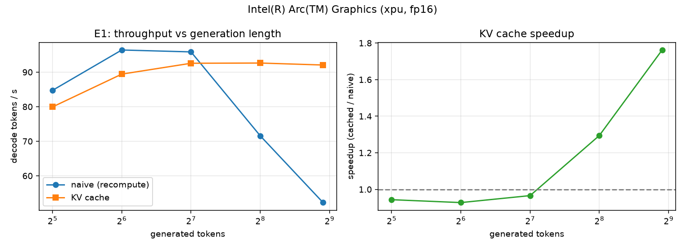
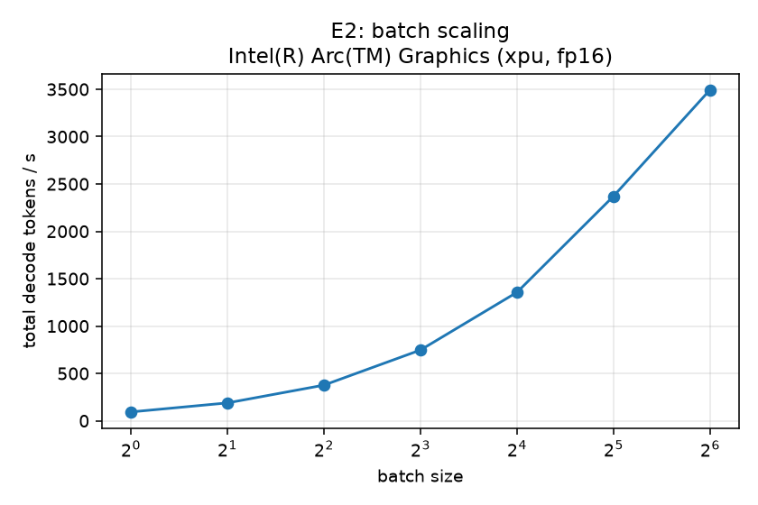
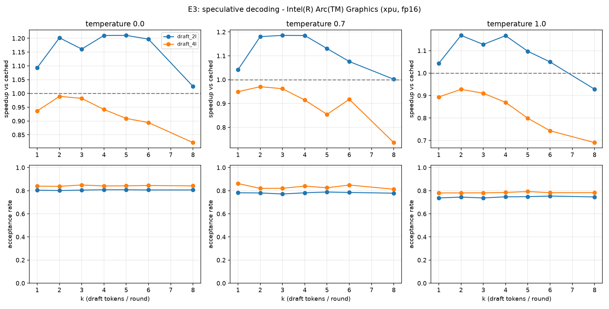
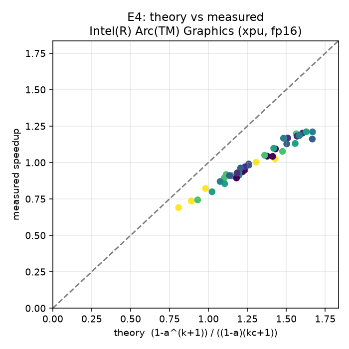

# TinyGPT

**A compact GPT language model trained from scratch, with KV-cache inference and speculative decoding experiments.**

TinyGPT is an experimental, decoder-only Transformer project built to explore the complete small-language-model workflow: tokenizer construction, model implementation, training, evaluation, inference optimization, and hardware benchmarking.

The main model has **27.80 million parameters** and was trained on the TinyStories dataset using an Intel Arc GPU through PyTorch XPU. The project also includes smaller draft models for speculative decoding and benchmarks comparing naive generation, KV-cache generation, batch scaling, and speculative decoding.

> **Benchmark environment matters:** the performance numbers in this README were measured on one Intel Core Ultra 7 155H laptop with integrated Intel Arc graphics. They are useful for comparing implementations on that machine, not as universal hardware rankings.

---

## System architecture



[View editable SVG source](docs/assets/tinygpt-architecture.svg)
## Highlights

- Custom byte-level BPE tokenizer with a vocabulary size of **4,096**.
- Decoder-only Transformer with **RoPE**, **RMSNorm**, and **SwiGLU** components.
- Main GPT model with approximately **27.8M parameters**.
- Training on approximately **552.5M training tokens** from TinyStories.
- Autoregressive generation with a KV cache.
- Speculative decoding using smaller draft models.
- CPU and Intel XPU execution paths, with smoke tests for both.
- Evaluation and benchmarking utilities for perplexity, throughput, and decoding performance.
- Hugging Face export validation; the tested export parity run reported a maximum logit difference of **0**.

## Model architecture

### Target model

| Component | Configuration |
|---|---:|
| Architecture | Decoder-only Transformer |
| Parameters | 27,795,968 (~27.80M) |
| Vocabulary size | 4,096 |
| Hidden dimension (`d_model`) | 512 |
| Transformer layers | 8 |
| Attention heads | 8 |
| KV heads | 8 |
| MLP hidden dimension | 1,408 |
| Maximum sequence length | 512 tokens |
| Positional encoding | RoPE |
| Normalization | RMSNorm |
| MLP activation | SwiGLU |

### Draft models

The draft models are smaller language models used by speculative decoding. Their purpose is to propose tokens cheaply so the target model can verify them.

| Draft model | Layers | Parameters | Checkpoint used in E3 |
|---|---:|---:|---|
| Draft 2L | 2 | 2,655,488 (~2.66M) | `runs/draft_2l/model.pt` |
| Draft 4L | 4 | 4,262,144 (~4.26M) | `runs/draft_4m_restart/model.pt` |

The four-layer draft configuration/checkpoint directory uses the project name `draft_4m_restart`; in the E3 benchmark output it is labelled `draft_4l`.

---

## Dataset and training

TinyGPT was trained using processed TinyStories token shards.

| Dataset detail | Value |
|---|---:|
| Training tokens | 552,538,022 |
| Validation tokens | 5,578,191 |
| Training stories | 2,717,480 |
| Validation stories | 27,630 |
| Tokenizer vocabulary | 4,096 |

The processed data is expected under `data/shards/`:

```text
data/
├── shards/
│   ├── train.bin
│   ├── val.bin
│   └── meta.json
└── tok/
    └── tokenizer.json
```

### Target training configuration

The final target run used a micro-batch size of 16 and gradient accumulation of 8, giving **65,536 tokens per optimizer step**.

| Setting | Value |
|---|---:|
| Epochs | 1 |
| Optimizer steps | 8,432 |
| Micro-batch size | 16 |
| Gradient accumulation | 8 |
| Tokens per optimizer step | 65,536 |
| Learning rate | 0.001 |
| Minimum learning-rate ratio | 0.1 |
| Warmup steps | 500 |
| Weight decay | 0.1 |
| Maximum sequence length | 512 |
| Training device | Intel XPU |
| Training dtype | BF16 |

### Training outcome

The completed training run reached step **8,432 / 8,432**. Its final training-run validation loss was **1.1391**, with a reported perplexity of **3.12**.

A separate evaluation command on the saved `model.pt` checkpoint produced the following result:

| Evaluation metric | Result |
|---|---:|
| Parameters | 27,795,968 |
| Validation tokens evaluated | 5,577,728 |
| Validation loss | 1.142847 |
| Perplexity | 3.13568 |
| Bits per byte | 0.41659 |

The training summary and standalone evaluation use their respective evaluation runs; the small difference in validation loss is retained rather than treating the two measurements as identical.

---

## Inference and optimization

### KV-cache generation

Naive autoregressive generation recomputes attention keys and values for the prior context at every generation step. With KV caching, previously computed keys and values are retained and reused.

On the latest E1 benchmark, KV caching was slightly slower at short context lengths, but became increasingly useful as the generated context grew.

**Latest E1 benchmark — Intel Arc XPU, FP16**

| New tokens / context setting | Naive (tok/s) | KV cache (tok/s) | Speedup |
|---:|---:|---:|---:|
| 32 | 84.7 | 79.9 | 0.94× |
| 64 | 96.4 | 89.4 | 0.93× |
| 128 | 95.9 | 92.6 | 0.97× |
| 256 | 71.6 | 92.6 | 1.29× |
| 480 | 52.2 | 92.1 | **1.76×** |

**Takeaway:** KV caching is most beneficial for longer contexts in this benchmark. It should not be assumed to improve every short-context workload.

### Batch scaling

E2 measured aggregate generation throughput across batch sizes. Aggregate throughput increased with batch size, while throughput per sequence decreased at larger batches.

**Latest E2 benchmark — Intel Arc XPU**

| Batch size | Aggregate throughput (tok/s) | Throughput per sequence (tok/s) |
|---:|---:|---:|
| 1 | 93.2 | 93.2 |
| 2 | 188.4 | 94.2 |
| 4 | 376.1 | 94.0 |
| 8 | 746.8 | 93.3 |
| 16 | 1,356.3 | 84.8 |
| 32 | 2,371.4 | 74.1 |
| 64 | **3,494.5** | 54.6 |

**Takeaway:** batch size 64 gave the highest aggregate throughput in this sweep, while batch size 8 retained approximately the single-sequence throughput. The measurements at batch sizes 16 and 32 showed higher run-to-run variability, so small differences should be interpreted cautiously.

### Speculative decoding

Speculative decoding uses a smaller draft model to propose several tokens. The target model verifies those proposals, potentially reducing the number of expensive target-model decoding steps.

Two draft models were benchmarked against target-model KV-cache generation. The repeated E3 run is used for the main comparison below because the first run had an abnormally low temperature-0.7 baseline, which inflated its reported speedups.

The target-only KV-cache baselines in the repeated run were **84.80 tok/s** at temperature 0.0, **87.53 tok/s** at temperature 0.7, and **86.16 tok/s** at temperature 1.0.

**Repeated E3 benchmark — Intel Arc XPU, FP16**

| Temperature | Draft model | Best K | Acceptance rate (α) | Tokens / round | Throughput (tok/s) | Speedup |
|---:|---|---:|---:|---:|---:|---:|
| 0.0 | Draft 2L | 5 | 0.81 | 3.70 | **103.1** | **1.21×** |
| 0.0 | Draft 4L | 2 | 0.84 | 2.53 | 84.4 | 0.99× |
| 0.7 | Draft 2L | 3 | 0.77 | 2.80 | **104.0** | **1.19×** |
| 0.7 | Draft 4L | 2 | 0.82 | 2.48 | 85.4 | 0.97× |
| 1.0 | Draft 2L | 2 | 0.74 | 2.30 | **101.0** | **1.17×** |
| 1.0 | Draft 4L | 2 | 0.78 | 2.39 | 79.6 | 0.93× |

**Takeaway:** Draft 2L was the better speed-oriented draft model in the repeated experiment, producing approximately **1.17×–1.21×** speedups across the tested temperatures. Draft 4L had competitive acceptance rates, but its additional draft-model cost prevented it from beating target-only KV-cache generation in this run.

---

## Hardware and software environment

The reported training and benchmark results were collected in this environment:

| Component | Environment |
|---|---|
| Laptop CPU | Intel Core Ultra 7 155H |
| GPU | Integrated Intel Arc Graphics |
| GPU backend | PyTorch XPU |
| Python | 3.13.15 |
| PyTorch | 2.14.1+xpu |
| OS / shell | Windows, PowerShell |

Training used BF16 on XPU. The reported E1 and E3 generation benchmarks used FP16. Results can change with power mode, thermal conditions, background processes, driver versions, and PyTorch/XPU versions.

---

## Running the project

The commands below assume the repository root is the current working directory, the virtual environment is active, and the processed dataset/tokenizer files are in the locations shown above.

### 1. Install dependencies

```powershell
python -m pip install -r requirements.txt
python -m pip check
```

Use a PyTorch build with Intel XPU support for the XPU commands. The exact installation command can depend on the supported PyTorch and Intel software versions for your machine; use the setup instructions in `docs/RUNBOOK.md` rather than installing a generic CPU-only build over an existing XPU environment.

### 2. Run tests

```powershell
pytest -q
```

The project test suite passed in the development environment used for these experiments.

### 3. Train the target model

```powershell
python -m tinygpt.train `
  --config configs/target_28m.yaml `
  --device xpu `
  --set train.micro_batch_size=16 `
  --set train.grad_accum_steps=8 `
  --set train.out_dir=runs/target_28m `
  --time-limit-minutes 120
```

The time limit allows a training session to save a checkpoint and stop cleanly. Resume from the saved checkpoint using the training script's `--resume` option when continuing a run.

### 4. Evaluate the target checkpoint

```powershell
python -m tinygpt.eval.perplexity `
  --ckpt runs/target_28m/model.pt `
  --data-dir data/shards `
  --device xpu `
  --dtype fp16
```

### 5. Generate evaluation samples

```powershell
python -m tinygpt.eval.samples `
  --ckpt runs/target_28m/model.pt `
  --tokenizer data/tok/tokenizer.json `
  --data-dir data/shards `
  --out results/samples/target_28m.md `
  --device xpu
```

### 6. Run benchmarks

**E1 — naive generation vs KV cache**

```powershell
python -m bench.run E1 `
  --target runs/target_28m/model.pt `
  --device xpu `
  --power-mode "plugged-in/best-performance"
```

**E2 — batch scaling**

```powershell
python -m bench.run E2 `
  --target runs/target_28m/model.pt `
  --device xpu
```

**E3 — speculative decoding**

```powershell
python -m bench.run E3 `
  --target runs/target_28m/model.pt `
  --device xpu `
  --drafts draft_2l=runs/draft_2l/model.pt,draft_4l=runs/draft_4m_restart/model.pt
```

### 7. Analyze benchmark results and generate plots

```powershell
python -m bench.analyze --results results
python -m bench.plot --results results
```

The benchmark outputs are written to `results/`, with plots under `results/plots/`.

---

## Repository layout

```text
.
├── bench/          # E1/E2/E3 benchmark runners and analysis
├── configs/        # Target and draft model configurations
├── data/           # Tokenizer and processed dataset shards
├── docs/           # Design notes and runbook
├── export/         # Model export utilities
├── results/        # Benchmark JSON, summaries, and plots
├── runs/           # Training checkpoints and run artifacts
├── scripts/        # Utility and smoke-test scripts
├── tests/          # Automated tests
└── tinygpt/        # Model, tokenizer, training, evaluation, and inference code
```

---

## Findings and limitations

- **KV cache:** the measured benefit depends on context length; short-context runs did not show a speedup in the latest E1 result.
- **Batching:** aggregate throughput increased substantially with batch size, but per-sequence throughput declined at larger batches.
- **Speculative decoding:** the smaller 2-layer draft model was more useful for throughput on this integrated GPU than the 4-layer draft model in the repeated E3 run.
- **Hardware utilization:** the E6 analysis estimated memory-bandwidth utilization at approximately 6.2%–8.9% for the measured E2 batch sweep. This indicates that the measured workload did not approach the estimated memory-bandwidth ceiling; it does **not**, by itself, prove that compute is the only bottleneck. Kernel launch overhead, synchronization, arithmetic intensity, and device utilization can also affect throughput.
- **Measurement variability:** the first E3 temperature-0.7 baseline was an outlier. The repeated run is used for the headline speculative-decoding results.
- **Scope:** this is a compact experimental model with a 512-token maximum sequence length, not a claim of parity with large production language models.

---

## Further work

Potential next experiments include:

- Repeat benchmark sweeps under controlled thermal and power conditions and report median plus variability.
- Compare additional draft-model sizes and speculative decoding values of K.
- Profile XPU kernel execution to investigate the gap between measured throughput and the estimated bandwidth ceiling.
- Evaluate quantization and additional deployment formats on the target laptop.

---

## License

Add the project's chosen license here before publishing or redistributing the repository. Also verify the applicable terms for the dataset and any third-party dependencies used by the project.

## Benchmark visualizations

### E1 � KV-cache performance



### E2 � Batch scaling



### E3 � Speculative decoding



### E4 � Theoretical vs measured speedup


