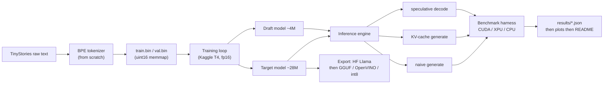
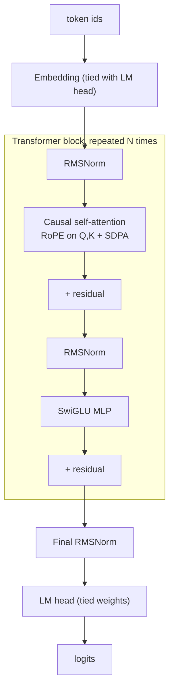
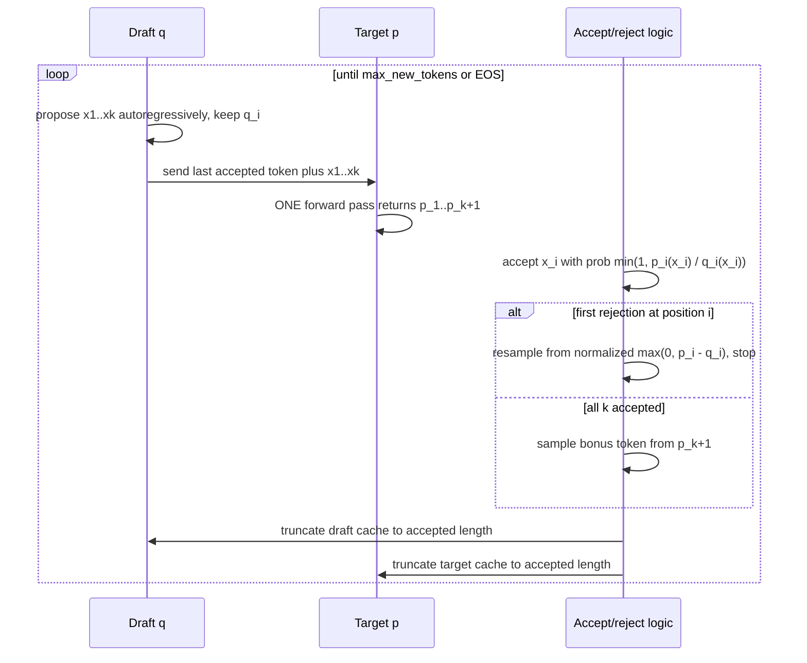

# Architecture

**Last updated:** 2026-09-30 · **Status:** Design v1 (nothing implemented yet — numbers are design targets)

## 1. System overview



**Design principle:** the model is a pure function `logits = model(tokens, cache=None, start_pos=0)`. Training, naive generation, cached generation, and speculative decoding all call the same forward pass; only the *driver loop* around it differs. That keeps the equivalence tests simple.

## 2. Tokenizer

| Aspect | Design |
|---|---|
| Algorithm | Byte-level BPE (GPT-2 style) |
| Vocab size | 4096 = 256 byte tokens + 2 special tokens + 3838 learned merges |
| Special tokens | `<\|endoftext\|>` (EOS / story separator), `<\|pad\|>` |
| Pre-tokenization | GPT-2 regex split (needs the `regex` package for `\p{L}` / `\p{N}`), so merges never cross word/space/punctuation boundaries |
| Training speed trick | Count pre-tokenized "words" once, then run merges over the *unique-word frequency table* instead of the raw text — turns hours into minutes in pure Python |
| Training data | 100–200 MB subset of TinyStories (RAM-safe on 16 GB) |
| API | `train(files, vocab_size)`, `encode(str) -> list[int]`, `decode(list[int]) -> str`, `save(path)`, `load(path)` |
| Verification | Round-trip test; compression parity vs HF `tokenizers`; export to HF `tokenizer.json` |

## 3. Data pipeline

```
raw .txt ──split on <|endoftext|>──► stories ──encode──► ids + EOS ──concat──► train.bin / val.bin (uint16)
```

- `uint16` is safe because vocab (4096) < 65,536.
- Training reads random windows of `ctx_len + 1` tokens from the memmap (input = `[:-1]`, target = `[1:]`), as in nanoGPT.
- **Known simplification:** windows may span story boundaries, so attention can cross an EOS. This is accepted in v1 (documented in ADR-009 candidates); a document mask is an optional improvement.
- Estimated corpus: ~0.5B tokens (**measure after tokenizing** and record in the README).
- Validation set: fixed by seed, never sampled during training.

## 4. Model

Llama-style decoder-only transformer. Choosing Llama conventions (RoPE, RMSNorm, SwiGLU, no biases) makes export to HF / GGUF straightforward.



### Configs

| Config | Role | d_model | Layers | Heads (Q / KV) | MLP hidden | Vocab | Ctx | Params (approx.) |
|---|---|---|---|---|---|---|---|---|
| `target_28m` | Target (default) | 512 | 8 | 8 / 8 | 1408 | 4096 | 512 | ~27.8M |
| `target_28m_gqa` | GQA ablation | 512 | 8 | 8 / 2 | 1408 | 4096 | 512 | ~24.6M |
| `target_42m` | Stretch | 640 | 8 | 10 / 10 | 1728 | 4096 | 512 | ~42.3M |
| `draft_4m` | Draft | 256 | 4 | 4 / 4 | 704 | 4096 | 512 | ~4.3M |

Head dim is 64 in every config. Parameter count per block ≈ attention (`2·d² + 2·d·d_kv`) + SwiGLU (`3·d·hidden`); embeddings add `vocab × d` once (tied).

### Design choices worth knowing

- **RoPE** applied to Q and K with absolute positions, so a cache-aware forward must be told `start_pos`.
- **Attention** via `F.scaled_dot_product_attention`. On T4 (Turing) FlashAttention-2 is unavailable, but the memory-efficient SDPA kernel works.
- **No dropout** — one epoch over ~0.5B tokens will not overfit a 28M model.
- **Weight tying** between embedding and LM head saves ~2M parameters.

## 5. Training

| Setting | Initial value (tune on tiny config first) |
|---|---|
| Optimizer | AdamW, betas (0.9, 0.95), weight decay 0.1 on matrices only (not norms/embeddings) |
| LR schedule | Linear warmup ~500 steps → cosine to 10% of peak; peak ~1e-3 |
| Batch | ~64k tokens/step (micro-batch 32 × ctx 512 × accumulation 4 = 65,536) → ~7–8k steps per epoch of ~0.5B tokens |
| Precision | fp16 autocast + GradScaler (T4 has no bf16) |
| Grad clip | 1.0 |
| Compile | `torch.compile` on CUDA (optional flag) |
| Checkpoints | Every ~15 min / 500 steps: model, optimizer, scaler, RNG states, data position → exact resume |
| Logging | Loss, LR, grad norm, tokens/s → CSV (+ optional W&B via Kaggle secrets) |

Throughput on T4 is an *estimate* (30–60k tokens/s); measure in the first 10 minutes of the first real run and update this doc.

## 6. Inference engine

Shared pieces: a seeded **sampler** (greedy / temperature / top-k / top-p) and a common `generate()` interface so benchmarks can swap strategies.

### 6.1 Naive generation (baseline)

Each step re-runs the full forward pass over the entire sequence so far: O(n²) total tokens processed.

### 6.2 KV cache

```python
class KVCache:
    k: Tensor   # [n_layers, B, n_kv_heads, max_len, head_dim]
    v: Tensor   # same shape
    length: int # number of valid positions (shared across the batch in v1)

    def update(self, layer: int, k_new, v_new):
        """Write k_new/v_new at [length : length+T]; return views of [:length+T]."""
    def advance(self, n: int): ...   # length += n, called once after all layers
    def truncate(self, n: int): ...  # length = n  -> O(1) rollback (no data movement)
```

- **Two phases:** *prefill* processes the whole prompt in one pass (compute-bound); *decode* processes one token per step (memory-bound).
- **Static preallocation** to `max_len` avoids per-step allocation and is CUDA-graph friendly.
- **Memory per token** = `2 × n_layers × n_kv_heads × head_dim × bytes`. For `target_28m` in fp16: `2 × 8 × 8 × 64 × 2` = 16 KB/token → 8 MB per 512-token sequence. With GQA (2 KV heads) it drops 4× to 2 MB.
- **v1 limitation:** one shared `length` per batch, so batched decode needs equal-length prompts. Ragged batches are a stretch item.

### 6.3 Speculative decoding

The draft model `q` proposes `k` tokens cheaply; the target `p` scores all of them in **one** forward pass; a rejection-sampling rule keeps the output distribution *exactly* equal to the target's.



**Theory (Leviathan et al., 2022):** with per-token acceptance rate α, expected tokens per round = `(1 − α^(k+1)) / (1 − α)`. With `c` = (draft forward cost) / (target forward cost), expected speedup = `(1 − α^(k+1)) / ((1 − α)(k·c + 1))`. Experiment E4 fits α and c from measurements and compares.

**Implementation subtleties (write tests for each):**

1. **Cache invariant:** each cache holds K/V for `tokens[0:len]`; the newest token is *not yet* cached. Every round starts by feeding each model the not-yet-cached suffix.
2. **All-k-accepted case:** the draft only *sampled* `x_k`, it never fed it through itself, so its cache is one entry short. Feed it at the start of the next round.
3. **Rollback:** after accepting `n` drafted tokens, target cache truncates to `L + n + 1` (last token plus `x_1..x_n`), where `L` is the cache length at the start of the round.
4. **EOS inside the draft block:** stop at the first EOS among accepted tokens; discard the rest.
5. **`q` must be the *actual* sampling distribution** (after temperature/top-k), and `p` must use the same processing, or the exactness guarantee breaks.
6. **Greedy special case:** accept iff `argmax p_i == x_i`; fully deterministic and used for the identity test.

## 7. Benchmark harness

- **Config-driven:** `bench.run --experiment E3 --device cuda --config bench/experiments/e3.yaml`.
- **Device abstraction:** one `sync()` that calls `torch.cuda.synchronize` / `torch.xpu.synchronize` / no-op for CPU.
- **Timing rules:** ≥3 warmup runs discarded; ≥10 timed runs; report median and IQR; fixed prompt set and seeds; EOS suppressed in throughput runs so every run generates the same number of tokens.
- **Output:** one JSON per run containing metrics + `env` block (device name, driver, torch version, dtype, git commit, plugged-in flag).
- **Plotting:** `bench.plot` regenerates every figure from `results/` — figures are never hand-made.

See [`BENCHMARKING.md`](BENCHMARKING.md) for the experiment matrix.

## 8. Export and interop

| Target | Route | Main pitfall |
|---|---|---|
| HF `LlamaForCausalLM` | Map weights to Llama names; write `config.json` | **RoPE convention**: HF Llama uses the "rotate-half" layout; if native RoPE pairs adjacent dims, permute Q/K weights on export (or use rotate-half natively from the start) |
| GGUF / llama.cpp | HF Llama → llama.cpp `convert_hf_to_gguf.py` | Tokenizer must be expressible in HF `tokenizer.json` format |
| OpenVINO | PyTorch → ONNX (or via `optimum-intel`) → OpenVINO IR; run on CPU and GPU | Dynamic shapes + KV cache handling; NPU is unlikely to work with a growing cache |
| int8 weight-only | Per-channel symmetric int8 for linear weights; dequantize in matmul | Measure val-loss delta, not just speed |

Every export gets a **logit-parity test** against the native model on fixed inputs.

## 9. Testing strategy

Correctness tests gate every performance experiment (full list in [`BENCHMARKING.md`](BENCHMARKING.md#3-correctness-tests-must-pass-before-any-benchmark)). Test layers: unit (tokenizer, RoPE, mask) → equivalence (cache vs full forward) → statistical (speculative sampling distribution) → parity (exports).

## 10. Code layout (as implemented)

```
tinygpt/
|-- tokenizer/  bpe.py (BPETokenizer, train_bpe)  train.py (CLI)
|-- data/       download.py  prepare.py (streaming, multiprocess)  loader.py (TokenData, memmap)
|-- model/      config.py (GPTConfig)  gpt.py (GPT)  kv_cache.py (KVCache)  io.py (save/load)
|-- infer/      sampling.py  generate.py (naive, cached)  speculative.py  cli.py
|-- eval/       perplexity.py  samples.py
|-- train.py    utils.py
bench/          run.py (E1 E2 E3 E5)  analyze.py (E4 E6)  plot.py  common.py
export/         to_hf_llama.py  tokenizer_to_hf.py  quantize.py  to_openvino.py  bench_external.py
tests/          test_tokenizer  test_model  test_kv_cache  test_speculative  test_data  test_train  test_export
configs/        target_28m  target_28m_gqa  target_42m  draft_4m  draft_2l  draft_4m_distilled  tiny_smoke  tiny_draft_smoke
```

**Implementation notes that differ from the original design:** the speculative verify pass uses an explicit boolean mask when
appending k+1 tokens to a non-empty cache; `temperature == 0` is represented as a one-hot distribution so greedy decoding is a
special case of the same accept/reject code path; benchmarks cap E1 at 480 new tokens so prompt + generation fits the 512 context.

## 11. Invariants to protect

1. `model(x)` with no cache ≡ prefill + step-by-step decode with cache (fp32, atol 1e-4).
2. Speculative decoding never changes the target's output distribution.
3. Any number in the README traces to a JSON in `results/`.
4. Training resume is bit-for-bit continuous in the loss curve.
